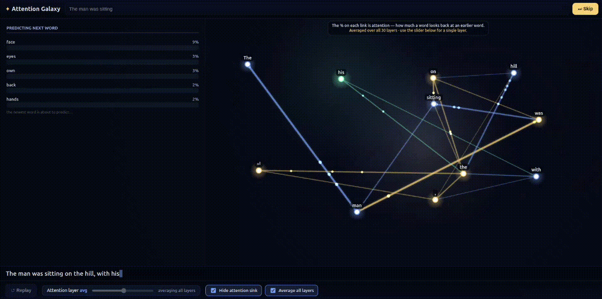

<div align="center">

# ✦ Attention Galaxy

**Watch a language model predict the next word — and *see* which earlier words it paid attention to.**



Attention Galaxy turns a transformer's inner workings into something you can
watch. Type a prompt and the model continues it one word at a time. For every
word it predicts, you see the candidate words it considered and their
probabilities — and, in the galaxy, exactly which earlier words it *attended to*
to make that choice, each connection labelled with a clear percentage.

[**▶ Try the live demo**](https://talhatahir-10xe.github.io/attention-galaxy/)

*A small 135M-parameter model runs right in your browser — no install, no sign-up.*

</div>

---

## What you can do with it

- **See attention, the real signal behind a prediction.** Every word becomes a
  star, wired to the earlier words it looked back at — so you can see *which
  tokens the model leaned on* to pick the next one, as a readable percentage.
- **Watch each prediction unfold.** For every word: the model looks back at the
  context, scores candidate next words, locks in a winner, and sends it into the
  galaxy — the whole mechanic, step by step.
- **Inspect any word.** Click a star (or a word in the sentence) to light up
  exactly where *its* attention went, ranked by strength.
- **Compare layers.** A transformer attends differently at each of its 30 layers
  — early layers catch grammar, middle layers meaning, late layers summary.
  Scrub the slider to see any single layer, or average them all.
- **Cut through the noise.** Toggle off the "attention sink" (the first token that
  soaks up attention everywhere) to reveal the connections that actually matter.

Useful for learning how transformers work, teaching attention, or just poking at
a real model's reasoning. The attention shown is the model's own — it faithfully
reflects which earlier words it used, not an approximation.

---

## How it works

```
Browser only
  Transformers.js tokenizer ──▶ onnxruntime-web  (SmolLM2-135M · int8 · WASM-CPU)
                                   │ logits → candidate words + probabilities
                                   │ attn   → per-layer attention (averaged heads)
                                   │ emb    → k-means star colours
                                   ▼
                              Canvas 2D galaxy + prediction panel
```

| Model | Runtime | Tokenizer | Rendering |
|-------|---------|-----------|-----------|
| [SmolLM2-135M](https://huggingface.co/HuggingFaceTB/SmolLM2-135M) (2024, 135M params, 30 layers), int8-quantized ONNX (~158 MB) | `onnxruntime-web` on WASM-CPU — works on laptops and phones, no special headers | the model's own tokenizer via [Transformers.js](https://huggingface.co/docs/transformers.js) | a single HTML5 Canvas with one `requestAnimationFrame` loop |

Decoding is greedy with a repetition penalty and no-repeat-ngram constraint, so
the output stays coherent rather than looping. The model is downloaded once (on
an explicit click) and cached by the browser thereafter.

### Why a custom ONNX export?

Standard ONNX exports don't expose attention weights — which is the one thing
this app is built around. `backend/scripts/export_onnx.py` wraps the model so it
outputs **logits + token embeddings + per-layer attention** (using eager
attention so the weights are real), exports to ONNX, quantizes to int8, and
bundles the tokenizer. The wrapper is architecture-agnostic, so GPT-2, Llama /
SmolLM2, Qwen and others all export the same way. You only need this to rebuild
or swap the model — the deployed app already includes everything it needs.

---

## Run locally

```bash
cd frontend
npm install
npm run dev          # http://localhost:5173
```

The galaxy starts empty. Click **Download model**, then type a prompt and press
**Generate**. In development the weights load from `frontend/public/model/`, so
no internet is needed after `npm install`.

### Build a static site

```bash
cd frontend
npm run build        # outputs ./dist
npm run preview
```

### Rebuild or swap the model (optional)

```bash
cd backend
python -m venv .venv && source .venv/bin/activate
pip install -r requirements.txt
python scripts/export_onnx.py                    # default: SmolLM2-135M
EXPORT_MODEL=gpt2 python scripts/export_onnx.py  # or any HF causal LM
```

This writes `*-int8.onnx` + `tokenizer/` + `model.json` into
`frontend/public/model/`.

---

## Deployment

The site is deployed to **GitHub Pages** by the included GitHub Actions workflow
(`.github/workflows/deploy.yml`), which builds `frontend/` and publishes it on
every push to `main`. Because the model file exceeds GitHub's 100 MB limit, the
weights are hosted separately on the **Hugging Face Hub** (CDN-backed and
CORS-enabled) and fetched at runtime — the model URL lives in `src/infer.js`. The
published site itself is only a few MB, so it stays well within Pages' limits.

---

## Project structure

```
attention-galaxy/
├── frontend/                   # the app (static, no runtime server)
│   ├── index.html
│   ├── src/
│   │   ├── main.js             # UI wiring, model download, controls
│   │   ├── infer.js            # in-browser generation (onnxruntime-web)
│   │   ├── galaxy.js           # canvas render loop, physics, links, panels
│   │   └── style.css
│   └── public/model/           # model.json + tokenizer (weights hosted on HF Hub)
├── backend/                    # build-time only: produces the ONNX model
│   ├── requirements.txt
│   └── scripts/export_onnx.py
└── .github/workflows/deploy.yml
```

---

## License

[MIT](LICENSE)
